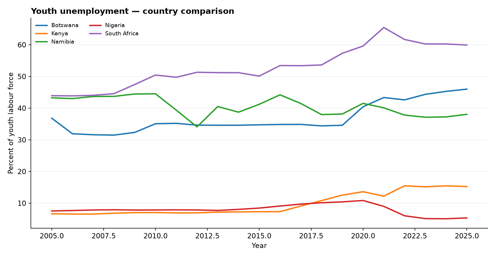
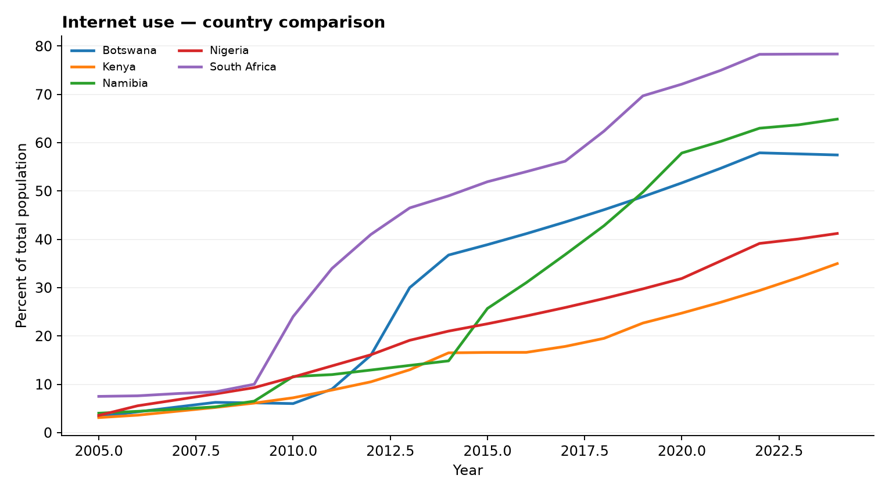

# 🌍 South Africa Opportunity Monitor

### Exploring youth unemployment, internet access and economic development across Africa

A reproducible **data analytics and visualisation project** built with **Python, Pandas, SQL, Plotly and Streamlit**. The dashboard explores socioeconomic indicators for **South Africa, Botswana, Namibia, Kenya and Nigeria**, helping users compare country-level trends and understand differences in economic context.

## 📊 Dashboard preview

These preview charts were generated with **synthetic demonstration data**:

## 🎯 Project objectives

- Compare youth unemployment trends across five African countries.
- Track access to the internet and examine digital inclusion.
- Explore GDP per capita and overall unemployment indicators.
- Use reproducible data processing and data-quality checks.
- Visualise trends in an interactive dashboard.
- Practice responsible interpretation of official socioeconomic data.

## 🛠️ Technologies

| Technology | Purpose |
|---|---|
| Python | Data processing and automation |
| Pandas & NumPy | Cleaning, validation, transformation and analysis |
| World Bank Indicators API & Requests | Downloading published socioeconomic data |
| Streamlit & Plotly | Interactive dashboard and charts |
| Matplotlib | Report-ready PNG visualisations |
| SQL | Additional exploratory analysis queries |
| Pytest | Automated tests |

## 🌐 Data sources

**Primary source:** [World Bank Indicators API](https://datahelpdesk.worldbank.org/knowledgebase/articles/889392)

| Indicator | World Bank code |
|---|---|
| Youth unemployment (% of labour force ages 15–24; modelled ILO estimate) | `SL.UEM.1524.ZS` |
| Individuals using the internet (% of population) | `IT.NET.USER.ZS` |
| GDP per capita (current US$) | `NY.GDP.PCAP.CD` |
| Total unemployment (% of total labour force; modelled ILO estimate) | `SL.UEM.TOTL.ZS` |

**Countries:** South Africa (`ZAF`), Botswana (`BWA`), Namibia (`NAM`), Kenya (`KEN`) and Nigeria (`NGA`).

The analysis requests **2005–2025**, subject to data availability. Not every country or indicator has a published observation for every year. Published values may be revised by the source.

## 💼 Skills demonstrated

**Data analysis · Data cleaning · Data quality · API integration · Exploratory data analysis · Time-series visualisation · SQL · Dashboard development · Reproducible workflows · Responsible interpretation**

[World Bank — API Basic Call Structures](https://datahelpdesk.worldbank.org/knowledgebase/articles/898581-api-basic-call-structures)

---
